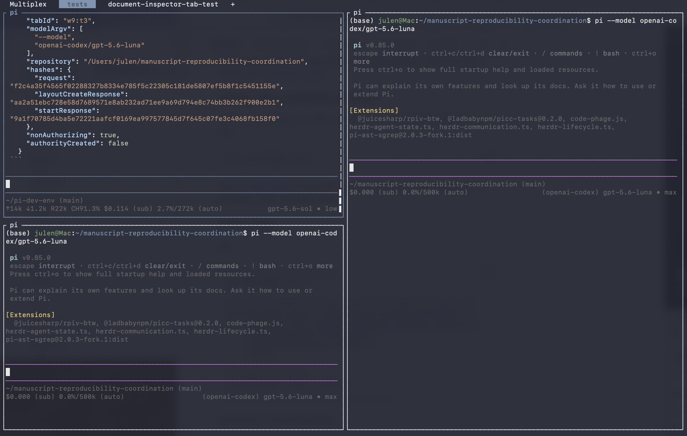

# pi-agentic-driver

<p align="center">
  
</p>

<p align="center">
  <a href="LICENSE"></a>
  <a href="https://www.npmjs.com/package/@evoclock/pi-agentic-driver"></a>
  
  
  
  
</p>

An agent without guardrails will sometimes rewrite code an existing abstraction already
covers. It will ship to the wrong remote. It will lose context and report
success without evidence. Pi is deliberately lean by design: the harness is yours to
shape. I built these extensions to shape mine, and you can use them to shape yours.
They bring the concerns I care about into the harness.

**pi-agentic-driver makes agent work verifiable and controllable. The agent does
the work and each extension helps you check it.** Reviewing happens
before an agent writes code. Communication uses reports without claiming authority it does not have.
Isolation proofs verify their own cleanup. Sessions can keep their place across
interruptions. You can check consequential Git operations before and after they run.

Features have different evidence levels: focused tests and independent review
support the shipped contracts. We claim live host-dependent proof only
where it has actually run. A receipt or worker report is evidence, not approval.

Configure Treehouse recycling in `config/treehouse.v1.json`. Treehouse is a
separate Go CLI, not an npm dependency. The config pins its supported CLI
version, which the extension checks before any return. Create worktrees from the repository root
with `treehouse get --lease --base main --branch <branch>`. The optional Pi
extension checks driver-held leases at session start and every five minutes.
It returns only idle, clean worktrees whose exact pushed head belongs to a
merged or closed PR. A missing PR, different head, unknown CLI version, dirty
checkout, or active process leaves the lease intact. It does not create
worktrees, clean files, merge branches, or remove slots.

Extensions for [Pi](https://github.com/earendil-works/pi-coding-agent):
advisory code review, controlled role communication, and governed isolation
proofs for agentic workflows.

<p align="center">
  
</p>

## Herdr spawn

Use `agentic_herdr_spawn_worker` to start Pi worker tabs and panes. Do not run Herdr commands from a bot shell. The guard blocks direct agent starts, prompts, reads, waits, and pane send-keys. Use `agentic_herdr_communication` to talk to a running worker.

In an eligible repository, you do not need to register the repository, create a named workspace, or approve each spawn. Restart Pi after installation to load the updated tool.

For trusted GitHub origins, use the repository name with its GitHub capitalization (for example, `MixedCaseRepo`). This works with SSH and HTTPS. The tool uses your configured default Pi model unless you choose another.

Already have an `AGENTS.md`? If you want this spawn path in it, copy the optional guidance from [`templates/AGENTS.md`](templates/AGENTS.md). See [`extensions/herdr-lifecycle.ts`](extensions/herdr-lifecycle.ts) and [`extensions/attended-authority-guard.ts`](extensions/attended-authority-guard.ts) for the implementation.

## Interactive safeguard configuration

Interactive confirmations are off by default. The attended-authority guard can ask before destructive actions, such as `git push` or overwriting a file. Use `agentic_interactive_safeguards_toggle` with `enabled: true` or `false` to change the setting. In the TUI, **Alt+Shift+S** changes the same setting and shows its state in the status bar. The shortcut does not open a settings dialog.

The toggle saves the setting at `$PI_CODING_AGENT_DIR/config/interactive-safeguards.v1.json`. By default, this file lives in the Pi agent config directory. You do not need to create this file to use the toggle. See `config/interactive-safeguards.v1.example.json` for an example. Turning the toggle off also clears saved command selections.

Choose one of two levels in the profile:

- Set `enableAllInteractiveConfirmations` to `true` to ask before every destructive tool call covered by this guard.
- Leave it `false` and list command prefixes in `enabledCommands` to ask only for those commands. For example, `"git push"` matches pushes with flags and arguments, including forced pushes. It does not match chained commands, pipelines, redirects, or shell substitutions. Add `"write"` or `"edit"` to confirm those Pi tool calls separately.

```json
{
  "schema": "pi-agentic-driver.interactive-safeguards.v1",
  "enableAllInteractiveConfirmations": false,
  "enabledCommands": ["git push"]
}
```

Both options are optional. Their defaults are false and an empty list. The profile must use the exact schema and a boolean switch. It accepts no more than 32 unique, lower-case, simple command names of up to four words each. Unknown keys, invalid types, unreadable files, and malformed JSON leave confirmations off. The guard warns without showing profile contents. A missing file uses the defaults without a warning.

This setting changes only the generic attended-authority confirmation. When you enable confirmations, headless destructive calls still fail closed. The guard blocks agent `write` and `edit` calls to the user profile's `config/` directory. Use the toggle, the TUI shortcut, or direct user profile editing to change the setting. Chat text and unrelated tool arguments cannot opt in. The guard is not a shell sandbox.

## Shipped features

| Tool | What it does | Status |
|------|--------------|--------|
| `code_phage` | Reviews a plan against a stated goal before your agent writes code. | shipped |
| `tasks` | Keeps a priority-ordered session plan, then lets the owner make selected items durable in `TASKS.md`. | shipped |
| `decision-to-spec` skill | Drafts one reviewable assignment from your explicit decision or a sourced, quoted relay, with observable outcomes and a stop point. | packaged skill |
| `agentic_decision_evidence` | Records where a direct or relayed decision came from, with a quote and time. It verifies no identity and grants no authority. | shipped |
| `agentic_relay_check_request` | Checks whether a recorded, scoped relay covers each requested private action; read-only preflight, with authority checked again at the action boundary. | shipped |
| `agentic_merge_review_record` | Records independent Standards and Spec verdicts for an exact PR head when configured for a review-based merge workflow. It does not merge a PR. | shipped |
| `agentic_herdr_communication` | Submits one prompt and observes delivery and marked reports; never grants authority. | shipped |
| `agentic_herdr_spawn_worker` | Starts and verifies one Pi worker tab in a trusted repository, reporting partial failures without an automatic retry. | shipped |
| `agentic_aidr` | A remedy for AI;DR. Reviews writing for clarity, simplicity, brevity, and humanity. | shipped |
| `agentic_linux_microvm_cutover` | Runs one job in a throwaway QEMU/KVM virtual machine on a Linux host, with a severity-tiered killswitch that stops escape attempts. | user-enabled, native confirmation |
| `agentic_worker_dispatch` | Runs bounded worker journeys and observes worker liveness. Each iteration is a durable checkpoint, so an interrupted journey resumes without resending an uncertain prompt; the `journeys` action lists the records. | shipped |
| `agentic_journey_outward_effect` | Confirms one push or private draft PR change for a journey. After an interruption, it checks the remote without replaying an uncertain write. | shipped, native confirmation |
| `agentic_kanban_board` | Shows the workspace task board: lanes, flags, priorities, dependencies, and which cards can run. | shipped |
| `agentic_kanban_board_write` | Adds cards to the board through the trusted writer, which records who authorized the work. | shipped |
| `agentic_kanban_board_update` | Moves, closes, flags, edits, or removes cards on the board, always recording who authorized the change. | shipped |
| `agentic_kanban_board_dispatch` | Claims an eligible board card for automated contained work and creates its assignment envelope. | shipped |
| `agentic_kanban_pulse` | Checks for ready work and available capacity, then starts assignments under the board policy. | shipped |
| `agentic-recovery-evidence` | Opens private recovery evidence in the local TUI; it is not a model-callable tool or recovery authorization. | shipped, local review only |
| Router | Capacity/policy routing for Board Pulse: seats with scope statements, tunable policy values, and a binding dispatch gate. | shipped |
| Janus (bundled service) | Local Jev evaluation service on loopback: semantic ranking, the dispatch-gate judgment, redaction before every external call. See `janus/README.md`. | shipped |
| `weekly-build-recap` skill | Prepares a local weekly GitHub recap with a picture and draft posts; posting remains yours. | shipped |
| Bounded loop-until-done | Keeps a session working toward an explicit stopping condition within configured limits; packaged since 2.0.0 and documented here. | shipped |

**Status: active development and testing.** The disabled NUDGE classifier and
private evidence store are foundations, not a running recovery ladder.
Herdr 0.9.1 has no proven modal-safe nudge channel. There is no terminal
`prompt` or `send-keys` fallback. Pending integrations below are not live.

Worker dispatch persists interrupted journeys by default and resumes from
durable checkpoints. Crash tests use a simulated Herdr adapter, a local Git
remote, and a simulated GitHub endpoint. Recovery in a live pane is not yet proven.

Busy workers can receive queued briefs or messages, but delivery is not a
completed answer. The driver calls an idle worker without a done marker
stalled, not complete; this replaces the old idle-eligible name.

See `scripts/enforcement/loop_until_done_guide.md` for the bounded loop's
limits. The weekly recap skill in `skills/weekly-build-recap/` writes only
local drafts.

## Code review and planning

*Extensions that review, route, and control what an agent does.*

<details>
<summary><strong>code-phage, advisory code review</strong> <em>(released, 0.1.1)</em></summary>

The `code_phage` tool reviews a proposed change against a stated goal before the agent
writes or commits code. Give it a goal, candidate files, accepted
requirements, and test paths. It will:

- **Find prior art structurally.** It matches exported symbols, function
  signatures, and dependency imports against a repository inventory, so the
  agent reuses an existing abstraction instead of writing a parallel version.
  Word overlap alone never counts. When prior art informs the result, the
  implementation records its source, version, and license.
- **Bind an implementation budget.** Goal, requirements, write set, and tests
  become one reviewable budget. Coverage checks flag requirements nothing
  binds and tests nothing covers.
- **Measure diagnostic signals.** Cognitive and cyclomatic complexity, line
  counts, duplication, module-level mutable state, dependencies, test burden.
  These are signals for human judgment, never rejection thresholds.
- **Redirect scope drift.** It names the files that support no accepted
  requirement and recommends the smallest coherent write set. The deletion
  test guards justified complexity: what would fail if we removed this?
- **Stay advisory.** It never mutates files, creates tasks, grants authority,
  or blocks work. Every result says `advisoryOnly: true`.

Concept credit: Matty Stratton, "Cognitive Complexity" (2024-09-20, concept
only, no code copied); `flake8-cognitive-complexity` 0.1.0, MIT (concept
only, not a runtime dependency).

</details>

<details>
<summary><strong>tasks, from session plan to durable work</strong> <em>(shipped)</em></summary>

Plans stay close to the work. They do not become board work by accident. The tasks skill gives Pi a familiar session list. It adds an owner-approved way to keep selected tasks in the durable `TASKS.md` board.

- **Keep the working list simple.** Use `TaskCreate`, `TaskGet`, `TaskList`, and `TaskUpdate` as usual. Set an optional P0–P3 session priority; ranked open work appears first, unranked work keeps ID order, and completed work appears last. Priority does not authorize board dispatch. The widget and footer stay live as tasks change.
- **Keep the Claude-like view.** `/tasks` provides descriptions, active forms, and internal-task markers without mutating the plan.
- **Make durable work deliberate.** `TaskPromote` never runs automatically. It previews the exact cards and destination before the owner confirms.
- **Keep authority clear.** The trusted board writer creates and updates `TASKS.md`. The skill does not bypass it.
- **Make migration gentle.** Existing task files remain readable. Moving to the driver-owned skill does not strand current plans.

The result is a clean handoff from a session plan to durable work. Selected tasks can survive the session, appear on the shared board, and become available for controlled dispatch when ready. A session priority is not copied into a board card without an owner-approved board action.

</details>

<details>
<summary><strong>decision-to-spec, one reviewable assignment</strong> <em>(packaged skill)</em></summary>

The `decision-to-spec` skill turns a decision into one reviewable planning
brief. Invoke `/skill:decision-to-spec` or ask for the workflow explicitly.
Pi can load the skill description on its own; loading is not evidence of a
decision and is not permission to draft.

- **Source the decision.** The brief records either your direct instruction
  or a relay that quotes your exact words with where and when you gave them.
  A bare approval claim or an unsourced quote is not decision evidence.
  `agentic_decision_evidence` structures the stated source; it verifies no
  identity.
- **Relay private approvals.** A configured relayer can record your exact
  answer, the question it answers, its source, channel, time, and bounded
  scope. `agentic_relay_check_request` is a read-only preflight; each action
  checks the record again. A relay attests that the configured relayer recorded
  your words; it does not prove identity or authorize merges or publication.
  See `docs/relay-authority.md`.
- **Settle what matters first.** The skill inspects the inventory, existing
  behavior and the affected driver capabilities, then asks one round of
  decisions that could change acceptance, scope, ownership, review or stop
  conditions, each with a recommendation.
- **Make outcomes observable.** Describe success and meaningful failure as
  Given/When/Then. Identify the best existing test seam and explain how it
  would catch a broken implementation.
- **Bound the work.** Owner, author, an independent standards and boundary
  reviewer, and an exact-artifact acceptance reviewer; exact paths and
  effects, the model, data and runtime route, exclusions, and a stop point.
  Implementation needs an identified Treehouse lease; drafting does not.

The output is a private planning brief for the requester, **not** a dispatch
record. It cannot approve a merge, release, deletion or force-push, write a
board card, create an issue, or change a provider route. Unresolved
decisions stay explicit instead of becoming assumed requirements.

Concept credit: Matt Pocock's `grill-with-docs`, `to-spec` and
domain-modeling skills, MIT (question-framing patterns only, no text
copied).

</details>

**Available now:**

- **task-ledger integration.** Agents can read and act within board card
  states while the trusted writer retains authority over admission,
  completion, reconciliation, and migration. The Tasks skill also bridges
  session planning to the durable `TASKS.md` board.
- **role and phase routing.** The router separates planning, implementation,
  review, and escalation phases. It reports endpoint warm state when
  configured. Warm-session preference remains future work; route affinity
  never overrides authority.

**Planned in this theme:**

- **prompted planning lifecycle.** Turn natural-language goals into complete
  proposals with parent and scope choices at native boundaries. No retry
  loops or model-supplied identifiers.
- **native assignment selection.** Choose planned assignments through a
  native UI over derived candidates, never through model-supplied targets.
- **inventory refresh.** Regenerate the Git-aware codebase inventory with
  verification receipts so prior-art matching stays honest.
- **project status and state review.** Add read-only views of workspace Git
  state, formal records, and task-state health.

<details>
<summary><strong>router, capacity/policy routing with a binding dispatch gate</strong> <em>(released, 0.9.2)</em></summary>

Board Pulse selects a route seat through the capacity/policy router. The
router reads a closed configuration file and a local-first SQLite file for
operational state (reservations, observations, route-decision audit).

Two router features call **Janus** — a separate local service, bundled under
`janus/`, that is the only component allowed to talk to the TypeSafe Jev
models:

- **Semantic ranking** (optional): Janus ranks up to eight eligible seats;
  on any Janus failure the router falls back to preference order.
- **The binding dispatch gate**: Janus judges whether a task fits the selected
  seat before the board claims it. No verdict, no dispatch — the
  gate fails closed when Janus is unreachable.

Janus binds loopback only (`127.0.0.1:8787`), reads its API key from the
macOS Keychain at runtime, redacts state before every external call, and
coalesces identical requests. See `janus/README.md` for the endpoint
contract, Keychain provisioning, and configuration.

- **Repository defaults** ship at `.agentic-driver/router.defaults.json`. The
template contains no accounts and one disabled placeholder seat, so it loads
out of the box and schedules nothing until you enable a real seat.
- **User profile (precedence over defaults):**
the configured router profile path, or the path in the
`AGENTIC_DRIVER_ROUTER_PROFILE` environment variable. A profile section
replaces the matching defaults section wholesale; the merged config must
validate or the router refuses to produce decisions (fails closed).
- **Operational state:** `~/.local/share/agentic-driver/router/state.db`, or
`AGENTIC_DRIVER_ROUTER_DB`. This store is operational state only. The
authenticated claims file and the board writer remain the only dispatch
authority; the system repairs SQLite from them, never the reverse.
- **Runtime requirement:** the operational store uses the built-in
`node:sqlite` module. You need Node.js 22.5 or newer.

<details>
<summary><strong>Tunable configuration values</strong> <em>(all keys required, defaults are conservative starting values)</em></summary>

Every numeric router policy uses a required configuration key, not a code
constant. The repository defaults below are starting values; your profile
can replace them. A missing key fails validation rather than guessing.

The configuration digest changes with each value. Routing decisions cached
under earlier values no longer apply.

| Section | Key | Default | What it controls |
|---|---|---|---|
| `eligibility.reserve` | `floorPercent` | 40 | Share of every quota window kept in reserve (per account, per window). Headroom for an unexpected burst and your next interactive session, without idling the account. |
| `eligibility.reserve` | `scope` | `account-window` | How widely the reserve floor applies (per account per window at launch). |
| `eligibility.reserve` | `coldStartFraction` | 0.25 | Consumption assumed for a seat with too little history: deliberately generous, so a mis-estimate fails eligibility instead of draining the account. |
| `eligibility.reserve` | `estimateSamples` | 20 | How many recent dispatches the consumption estimate averages: enough to smooth outliers, quick enough to track a model change. |
| `eligibility.reserve` | `estimateMinSamples` | 5 | Below this many observations, the estimator treats the average as noise and uses the cold-start value instead. |
| `eligibility.reserve` | `estimateOutlierSigma` | 3 | Outlier cut for the estimate: one unusually slow dispatch cannot inflate the average, real tail latency is kept. |
| `eligibility.reserve` | `ownerInteractiveOverride` | false | Whether your own interactive dispatches bypass the reserve rule (they do not, at launch). |
| `ranking` | `janusUrl` | `http://127.0.0.1:8787` | The local Janus evaluation service endpoint used for semantic ranking. |
| `ranking` | `maxCandidates` | 8 | The router ranks at most eight eligible seats per request; preference order trims the list first. |
| `ranking` | `fallback` | `preference-order` | What happens when ranking is unavailable: dispatch falls back to your preference order and never blocks. |
| `gate` | `threshold` | 0.9 | The dispatch gate's confidence threshold. A task is only dispatched when the evaluation clears it. Lower it only with evidence from your own audit log. |
| `gate` | `timeoutMs` | 8000 | How long the gate waits for an evaluation. On timeout there is no verdict, and the gate blocks dispatch (fail closed). |
| `gate` | `requestBudgetTokens` | 30000 | Maximum size of a gate evaluation request. Normal evaluations use under a thousand tokens. |
| seat record | `maxConcurrency` | 4 | How many workers one seat may run at once. The default suits a typical single machine or hosted seat. Tune it per seat: a cluster takes more, a constrained subscription endpoint may take less. |
| automation policy | `maxConcurrent` | 4 | How many workers may run at once across all seats. The default is a conservative start. Tune it to the capacity you actually have, and raise it when you add seats or hardware. |

Seat names describe infrastructure, not models: `dgx-spark`,
`dgx-spark-cluster`, `mac-studio`, `mac-studio-cluster`, `strix-halo`,
`strix-halo-cluster`, `merge-gateway-worker`. The model is a mutable field on
the seat, so changing models never renumbers your configuration. Each seat
also carries `scopeStatements`: plain-language descriptions of what the seat
is for. The dispatch gate reads them when judging whether a task fits.

</details>

</details>

<details>
<summary><strong>Janus, local Jev evaluation service</strong> <em>(shipped)</em></summary>

Janus is the local evaluation service bundled in this repository under
`janus/`. It is the only component allowed to talk to the TypeSafe Jev
model. It wraps the official TypeSafe SDK. It exposes one evaluation endpoint
and health probes on loopback. The router's semantic ranking and binding
dispatch gate call it. Nothing else in the harness talks to Jev directly.

**Guarantees:**

- **Loopback only.** Janus binds `127.0.0.1:8787` and nothing else. There is
  deliberately no bind-address option: it is a local tool.
- **Key stays in the macOS Keychain.** Janus reads the TypeSafe API key at
  runtime with a guarded `security` lookup. It never passes the key to
  subprocesses. It never writes the key to logs or transcripts.
- **Redaction before every external call.** A secrets/PII pass runs over the
  state before anything leaves the machine. No disable knob exists.
- **Single-flight.** Janus coalesces identical requests. It caps distinct
  in-flight evaluations. It rejects overflow with `busy` instead of queuing
  silently.
- **Controlled requests.** Janus enforces a 30k-token request budget. It
  rejects oversized requests instead of truncating them.

**Running it:**

```sh
cd janus
```

```sh
sfw npm install
```

```sh
npx tsx janus/server.ts
```

For a persistent setup, use the launchd template at
`janus/user.janus.plist`. Provision the TypeSafe Direct key once in the
Keychain. The command is in `janus/README.md`.

**When Janus is down:** semantic ranking falls back to preference order. The
binding dispatch gate blocks dispatch and fails closed. Janus never becomes a
silent dependency: its absence is loud.

See `janus/README.md` for the full endpoint contract, the error taxonomy, and
configuration.

</details>

## Multi-agent communication

*Extensions for controlled coordination between agents.*

<details>
<summary><strong>herdr-communication, controlled role communication</strong> <em>(released, 0.2.1)</em></summary>

The `agentic_herdr_communication` tool exchanges controlled, marked reports with
configured Pi worker roles running under [Herdr](https://herdr.dev/) (validated
against Herdr 0.9.1; the trust seam accepts the Homebrew-managed herdr binary
across versions rather than pinning one).

- **List and observe.** The integration checks each observed sibling checkout's
  canonical Git identity and configured origin owner. It does not require a
  registry entry. Worktree targets require a matching Treehouse lease; a
  the tool refuses symlink-escaped checkouts.
- **Submit once and observe separately.** A prompt returns an immediate,
  non-authorizing delivery receipt. The `delivery` action can report queued,
  delivered, answered, failed, unknown, or unattributed. The tool ties a marked
  answer only to its own delivery boundary and exact correlation line;
  missing or ambiguous evidence is never called success.
- **Wait and read.** The same trust checks apply to settlement and marked
  reports. Unknown delivery never causes an automatic retry or resend.
  Duplicate submissions within the bounded uncertainty window return the
  existing delivery ID, not another handoff.
- **Grant nothing.** Fixed argv, `shell: false`, a pinned executable, the
  coordinator role class denied. Results come back as untrusted evidence. The
  tool cannot control panes, start agents, run shells, or create authority.
- **Scale to many workers.** Eligible sibling repositories can use dynamic
  non-coordinator roles. Fan-out is sequential by design: one role per
  prompt, one complete exchange, no broadcast primitive.

</details>

<details>
<summary><strong>herdr-lifecycle, role-labelled worker dispatch</strong> <em>(released, 0.2.1)</em></summary>

The `agentic_herdr_spawn_worker` tool turns one natural-language request into Herdr's
native lifecycle. Choose tab placement, a safe role label, a model from the
active Pi model roster, and a trusted repository. The extension:

- creates a labelled tab in the coordinator's existing workspace (it refuses coordinator pane splits);
- starts exactly one Pi agent in it;
- verifies the role, model arguments, pane identity, and canonical repository;
- resolves the model against the installed Pi roster; exact installed models
  from known subscription providers need no individual route entry in
  `config/model-route-policy.v1.local.json`, while unknown providers,
  forbidden routes, ambiguous names, and unbudgeted gateways still fail closed;
- optionally accepts one explicit worktree target: it must be the canonical Git
  worktree root of that same eligible repository and carry an active
  Treehouse lease observed read-only; the tool checks it again after preflight
  and between mutations;
- starts ordinary guarded workers without a per-spawn grant or native dialog;
  an explicitly supplied legacy ledger grant is still validated;
- when you supply a legacy grant, requires it to cover the repository, action,
  model, role and exact worktree path; ordinary spawns instead verify Git
  identity, origin owner, and active lease identity;
- treats an explicit empty `models` or `roles` list on a ledger grant as any
  model or role; a missing list still fails closed;
- uses fixed argv with `shell: false` and no arbitrary Herdr or shell surface;
- returns explicit `pane_created`, `tab_created`, or `agent_started` partial
  states when only part of the operation succeeds; and
- never retries, moves, closes, or deletes created state automatically.



See [Dispatching a Multi-Model Workforce from Anywhere](https://evoclock.github.io/fieldnotes/articles/herdr-natural-language-agent-automation.html)
for the wider task and model-routing workflow.

</details>

<details>
<summary><strong>herdr-dispatch, continuous worker journeys</strong> <em>(released, 0.5.0)</em></summary>

The `agentic_worker_dispatch` tool runs controlled worker journeys and observes worker
liveness. Two actions:

- **pulse** reports whether a worker role is alive, its current state, and
  whether it is dispatch-eligible.
- **dispatch** runs one journey. The worker works through the existing task
  sequence, one prompt-and-report exchange per task, at most `maxSteps`
  steps (default 50, cap 200).

Continuous mode is the default: the journey keeps going until the worker
finishes the queue or reaches the step bound. Turn-by-turn mode stops after
each step and is explicit opt-in. Each journey emits one collated marked
report covering every step.

A worker that never reaches idle across the observed exchange cycle ends the
journey with an explicit unresponsive state. You can then spawn a replacement
through the guarded lifecycle boundary. The replacement resumes the same
pending tasks, reuses existing task cards, and never duplicates them. The
stuck exchange is never resent to the same worker.

Journeys never create, own, or complete task cards themselves, never retry
silently, and return results as untrusted evidence.

</details>

<details>
<summary><strong>loop-until-done, bounded session-task loops</strong> <em>(packaged since 2.0.0)</em></summary>

`/loop-until-done <steps> <approved goal> :: <observable exit check>` gives
one already-authorized coordinator session task a fixed worker-dispatch budget.
Configure the limits and wake in `.agentic-driver/loop-until-done.defaults.json`.
The defaults allow at most 200 attempts or 30 minutes, whichever comes first.
Each attempt consumes a step before dispatch. After a successful exchange,
the default wake prompts a check immediately; an interval can delay that prompt.
Each wake asks the agent to check the original exit condition before another
dispatch. You cannot extend or restart the per-session allowance. This
command does not dispatch board cards; Board Pulse owns those.

The 2.0.0 npm package file list includes the extension, its defaults, and its
guide. See `scripts/enforcement/loop_until_done_guide.md`.

</details>

<details>
<summary><strong>durable dispatch, resume after interruption without resending</strong> <em>(shipped)</em></summary>

`agentic_worker_dispatch` keeps each journey on disk, so a crash or restart
in the middle of a journey neither loses its place nor repeats a prompt.
Persistence is on by default. It is built on Pi Durable, not on a separate
state machine.

- **One durable task per iteration.** Each journey iteration is one Pi
  Durable task. The driver commits a checkpoint before every pane send, and
  Pi Durable resumes the task after a restart. A caller can supply a
  `journeyId` (letters, digits, `_` or `-`, up to 100 characters); ad-hoc
  work gets a generated one.
- **A tag in every prompt.** Each dispatched prompt ends with
  `[journey:<id>:<iteration>]`. After a restart the driver looks for that
  tag in the pane before it decides anything.
- **Block, never resend.** An iteration that had not yet sent its prompt
  rechecks worker liveness and asks for native confirmation again before it
  sends. Once a send has started, recovery only observes. One clean tag
  followed by one attributable role report settles the iteration. A tag
  without a report triggers polling for about two minutes, then blocks. A missing
  tag or an unreadable pane blocks: a missing tag is never proof that the
  prompt did not arrive. An abandoned pending task with no caller waits at
  most 30 seconds, then settles blocked.
**Packaged since 3.1.4.** Journeys accept `review_requested` and `blocked`
as consume reasons. Reservation repair keeps both reservations held when a
worker start cannot be verified. Durable cancellation can still record a late
receipt; dependent cards wait until the earlier card has `done === true`.
The fixed-machine controls are also available through REST and MCP commands.
Worker starts recognize mixed-case Git checkout paths that refer to the same
folder.

- **Inspect journeys.** The `journeys` action lists bounded journey records
  for the current repository (journey, iteration, state, task and card),
  optionally filtered by role or journey ID. It grants nothing.
- **One store per session, one owner per store.** The extension opens a
  private store for each stable Pi session ID on first use, not at import. A
  lock records the owner's PID, hostname, process start time and release
  token. The store refuses a live competing owner. It reclaims a stale lock
  only when it can prove its same-host owner has died; unknown ownership, or a host whose
  `ps` cannot report a process start time, refuses.
- **Keep the record small.** The index holds bounded identities and
  attributed report bodies, not briefs or terminal snapshots. A report is
  evidence, never owner completion.

**Evidence.** Crash tests kill the dispatch process before the send, after
the send and after the result, then restart it without help. Pane-history
tests cover five cases: tag found, tag found with a late report, tag
missing, history too short, and a wrapped tag. Only the first two settle;
the rest block. CI runs these on every pull request. They
exercise the real dispatch code against a simulated Herdr adapter. Recovery
in a live deployed pane, an independent live restart, and power-loss
durability (SQLite runs in NORMAL mode) are not yet proven. Node.js 22.19.0
or newer is necessary. See `docs/durable-persistence.md`.

Credit: Pi Durable (`@earendil-works/pi-durable`) 1.0.4 by Earendil Works,
MIT. The driver installs it as a pinned dependency instead of copying its source.

</details>


<details>
<summary><strong>task board and Pulse, planned and automated work you can see</strong> <em>(released, 0.9.1)</em></summary>

Keep planned work in canonical `TASKS.md`. You can read it directly or use
the generated `board.md` view in Obsidian. Agents use the same canonical
record through natural-language board tools.

You can tell an agent to add, edit, move, block, propose, close, or remove a
card. The trusted writer assigns its ID, checks its fields, records your
instruction, and protects its dispatch provenance.

Agents cannot invent additional work or complete a card on their own. An
agent report is evidence for your review. Only your clear instruction or
direct board action completes the card.

For automated work, you set an explicit policy for the board. It defines:

- allowed roles and repositories;
- contained placement;
- the maximum concurrent work;
- the policy expiry; and
- the risk ceiling.

Without a valid policy, the board refuses automated dispatch.

The `agentic_kanban_board_dispatch` tool claims the highest-priority eligible card. It
creates a single-attempt assignment envelope that binds the card, repository,
starting revision, assigned branch, allowed paths, stopping point, expiry, and
interaction profile.

Blocked, altered, expired, reused, or unauthorized assignments fail closed.
Board Pulse handles board assignment with full route evidence. The session
worker journey does not claim board cards or mint board envelopes.

Consuming an envelope releases the claim. It does not mark the card done.

External board clients submit `agentic-driver.board-claim-request.v2` to
`claimFromBoardRequest`. Receipts use `agentic-driver.board-claim-receipt.v2`,
route digests use `agentic-driver.board-claim-route.v2`, and asynchronous
transport receipts use `agentic-driver.async-transport.receipt.v2`. Clients
must use these names; the driver rejects prior request, receipt, and route contracts,
with no compatibility aliases. Unsupported request schemas fail closed.
Workspace capabilities live at
`.agentic-driver/capabilities.json`; route seats and providers use `board-`
and `board-router` identities.

Claims and envelopes are kept in authenticated state beside `TASKS.md`. The
derived `board.md` view shows active claims but never becomes an authority
source.

The `agentic_kanban_pulse` tool checks the board for ready work and available capacity.
A check only reports which work is ready to run. It does not claim cards.

Interactive host work needs explicit policy and one native confirmation for
the batch. Automated work requires containment and never falls back to the
host.

Coming next:

- contained Pulse execution through an approved isolation boundary;
- expanded external board support for the shared card fields; and
- our own Obsidian plugin for canonical `TASKS.md`.

</details>

- **project status and state review.** Read-only projections of workspace Git
  state, formal records, and task-state health.
- **role-lane routing and warm sessions.** Separate lanes handle
  implementation, planning, and review, and the router prefers a warm session
  so context and cache survive across tasks. Route affinity is an
  optimisation, never authority: an incompatible lane yields an explicit
  review-required result, never silent model substitution.
- **task-ledger integration.** Agents read and act within the task ledger's
  card states without owning board authority: no admission, completion,
  reconciliation, or migration by the agent itself.

## Writing clearly

*AI;DR (AI; Didn't Read) keeps technical writing clear without flattening the
writer's voice.*

<details>
<summary><strong>AI;DR, writing review</strong> <em>(released, 0.4.2)</em></summary>

The `agentic_aidr` tool reviews the last assistant response, supplied prose, or a
Markdown file. It checks four principles:

- **Clarity.** Each sentence carries one useful idea.
- **Simplicity.** Clutter, pompous phrases, and needless jargon go.
- **Brevity.** Fewer words when they carry the same meaning.
- **Humanity.** An authentic human voice stays.

The `simple` and `ste` modes add an ASD-STE100-informed profile: sentence
length, direct word choice, precise verbs, and clear requirements,
permissions, abilities, and conditions. It targets 20 words per procedural
sentence and 25 per descriptive one, and returns the rule and an example for
each finding.

The profile is advisory. It does not include the licensed ASD-STE100
approved-word dictionary and does not certify conformance. Check final text
against the licensed specification and your project terminology list.

AI;DR also flags dense paragraphs, suggests bullets when they reduce working
memory load, and supports plain-language and analogy modes. Review is
read-only. An explicit file apply action shows a git diff and writes the
exact replacement only after native confirmation. Release 0.4.2 adds controlled
inputs, atomic replacement, drift checks, and exact write verification.

</details>

## Sandboxed execution

*Extensions that run agent jobs in a sealed environment and prove it.*

**Available in this release:**

<details>
<summary><strong>microVM isolation</strong> <em>(user-enabled, native confirmation)</em></summary>

The `agentic_linux_microvm_cutover` tool runs a single job inside a throwaway
QEMU/KVM virtual machine on a Linux host. The job cannot reach the host, the
network, or anything else outside the machine. The system deletes the machine
after the job ends.

Isolation is off at the start of every session. Use the `/agentic-isolation-enable`
command in the Pi TUI, and confirm. The model cannot run
that command. Every cutover run asks for its own confirmation too. The tool saves nothing to settings, and headless sessions stay blocked.

### You choose the machine

The model can only relay your words. Saving a target, or running on one,
always requires your confirmation dialog first.

1. Tell the agent where to run the proof, for example "run the microVM proof
   on deploy@192.168.1.50" or "run it on this machine". The first run asks
   you to confirm. Your Yes saves the choice to your Pi config and the run
   continues.
2. Run `/agentic-isolation-enable` and confirm.
3. Each cutover run asks for its own confirmation. Later runs reuse the saved
   target without asking where the microVM runs again.

The tool discovers the technical details from the machine itself:
architecture, kernel, libvirt driver. You configure nothing. Before any run,
the probe checks three requirements: `/dev/kvm` is accessible, libvirt
reports the system-level driver, and a matching `qemu-system-<arch>` binary
exists. A failed check denies the run before anything happens. The shipped
fixture guest is x86_64-built, so the full proof currently needs an x86_64
KVM host.

### What example tests look like

We started with one payload: print a greeting, then call a network tool. The
greeting printed, the tool tripped the killswitch at the HIGH tier, and the
line after it never ran. A kill report landed in the state directory naming
the rule and tier, and the teardown proof showed the machine was gone with
nothing left behind.

From there we wrote a payload for every rule in the taxonomy: credential
probing behind chained commands, secret dumping inside subshells, package
installs, coordination files reaching for other agents, a forged receipt, a
write to the evidence channel, and ten unclassified commands in a row to push
the anomaly threshold to its limit.

The guest had no disk, no network, no host share, no credentials, and no GPU.
The guest could mount only the kernel's virtual filesystems. The monitor
denied and logged every other attempt; the log outlived the machine.

While this is a toy test of sorts my own personal work will be running on
these as well.

### What the containment layer defends against

Agent escapes tend to follow a playbook, and the published incidents from
frontier labs (the HuggingFace incident among them) read like one: grab
credentials, phone home, install something persistent, rewrite your tools,
stage payloads in caches, look for other agents to recruit, clean up the
evidence. The containment layer has a rule for each step:

- **Credential theft.** Reading SSH, cloud, or token material, or dumping
  environment secrets, ends the session immediately.
- **Exfiltration and remote control.** Any network tool, any socket, ends the
  session immediately.
- **Persistence through dependencies.** Package installs, registry writes,
  and manifest tampering trigger denials and increment the count. Repeat the attempt and the
  session ends.
- **Self-modification.** Rewriting the agent's own tools or the monitoring
  layer triggers a denial and increments the count.
- **Payload staging.** The monitor samples cache and package directory sizes;
  repeated growth ends the session.
- **Cross-agent escalation.** Coordination channels and shared paths used to
  reach other agents end the session immediately.
- **Evidence tampering.** Editing logs, forging receipts, or writing to the
  console channel ends the session immediately.
- **Reconnaissance.** The monitor counts attempts to probe the sandbox for
  watchers in a concealment index that ships in the run receipt.

A tamper-evident, digest-chained log keeps denials beyond the session. A trip
produces a kill report naming what happened and proving cleanup completed.

### Proven against real machines

Every rule above has been run against a real QEMU/KVM guest with a payload
built to trigger it. The kill switches fired where they should, the denials
stopped the jobs, and the cleanup held. One boundary is worth stating: two
rules watch the same directories by design, and together they are stricter
than either alone. Automated tests cover the growth-sampling trip; a live run
does not.

</details>

<details>
<summary><strong>autonomous journeys, overnight operation</strong> <em>(released, 0.7.0)</em></summary>

Dispatch a worker journey that runs end to end while you are away. The
journey proceeds through steps without pausing for confirmation, replaces
agents that get stuck, and records everything in one report you read when
you come back.

Your words alone set autonomous mode. Say "run these overnight end to
end" or "don't wait for me" and the journey runs in autonomous mode. Say
"do these two things" and it runs in the normal mode, pausing for you
between steps. The report records the mode either way.

`agentic_worker_dispatch` observes coordinator session tasks through a
read-only task store; dispatch no longer fails for lack of that store.
Interactive steps require native confirmation. Autonomous journeys follow
the session's existing autonomy semantics. Board cards in canonical
`TASKS.md` go through Board Pulse and `agentic_kanban_board_dispatch`,
which own the route evidence needed for claims and envelopes. The session
journey never claims board cards.

### The cast

You name the agents for the journey, and that list becomes the standing
permission. If the implementer gets stuck at 3am, a replacement spawns
automatically: same role, same model, both in the list you authorized.
If a task needs an agent you didn't name, the report records the attempt and
that thread stops. Nothing outside your list can appear while you sleep.

Dispatch fixes the cast; it never grows. It can only shrink in
practice (roles finishing their work), never widen.

### When agents get stuck

A stuck agent doesn't block the journey. The journey detects the stall,
spawns a replacement from the cast, and the replacement starts with a
mandatory gap analysis: read the task spec, inspect the repository, consult
the journey history, and state what remains before resuming. The replacement
must show that the remaining work is smaller than what its predecessor left.
If it can't, the journey stops that role and continues with the others.

### The morning report

One block tells you what happened: the terminal state, each step's outcome,
every replacement with its gap analysis and progress judgment, and any
denials. Every claim cites a receipt or report excerpt. No prose
narrative to reconstruct; you read the report and know exactly where things
stand.

</details>

<details>
<summary><strong>attended-authority guard</strong> <em>(released, 0.7.0)</em></summary>

The attended-authority guard lets you opt in to confirmations for destructive
tool calls. Confirmations are off by default. Choose all covered calls or
specific commands in the interactive safeguard profile described above.
When confirmations are on, headless destructive calls fail closed. Denials
are visible, and the guard is not a shell sandbox.

If you want a review-based merge workflow, configure merge policy separately.
It is optional, not a default requirement. See `docs/merge-policy.md` for
its supported settings and limitations.

</details>

**Under development in this theme:**

- **native macOS container proof.** The native Apple Container runtime has
  passed a fixed local isolation qualification: read-only repository mount,
  no network, automatic removal. The native Pi adapter is not yet part of the
  released package.

## Session continuity

*Managing context pressure, compaction, and avoiding lossy handover.*

**In development:**

- **context-pressure handling.** Pressure detection, non-lossy handover,
  compaction completion without cancellation loops, and continuation of the
  latest user goal. Development-only until the full live journey passes.
- **lossless session-reference compaction.** Selective, lossless retrieval of
  exact pre-compaction content, addressing factual degradation across
  repeated compactions. Designed as an optional add-on, not yet implemented.

**Planned in this theme:**

- **handover, checkpoint, and recovery.** Durable repository-local handover
  notes, governed checkpoint mutation, watchdog handoff, and fresh-session
  resumption that identifies goal, changed files, checks, and next step
  without executing anything.
- **recovery journey.** A private exact-evidence store and read-only TUI review
  come with the package. Trusted journey authorization, safe handoff, durable unknown-
  delivery lock, and a modal-safe nudge channel are still missing. No recovery
  action can start from a stored hash, receipt, or display token.
- **broader evidence ledger.** Deterministic indexing, lossless projection,
  checkpoint produce/store/recover, and tested multihost reconciliation remain
  planned beyond the bounded private store.
- **offline multihost evidence.** Record run evidence on each host while
  disconnected and reconcile it deterministically on reconnection, with no
  host as sole authority.

## Working with Git safely

*Extensions that keep routine Git low-friction and consequential Git guarded.*

**Available now:**

<details>
<summary><strong>outward effects, confirmed Git push and draft PR recovery</strong> <em>(shipped)</em></summary>

The `agentic_journey_outward_effect` tool makes one consequential Git or
GitHub write for an existing journey: a push, a private draft pull request
creation, or a draft pull request update. It records what it is about to do
before it does it, so a restart can tell a planned write from an uncertain
one.

- **Record intent first.** Each effect is its own Pi Durable task, committed
  before the tool calls Git or GitHub. A push binds the branch, the expected
  remote head (none for a new branch) and the target commit. A PR call binds
  the head, branch, base, and digests of the title and body; an update also
  binds the PR number and the prior body digest. The tool uses the PR body
  for that call only; it does not store it.
- **Observe, never replay.** After an interruption the tool reads the remote
  with `git ls-remote` and `gh api` and never repeats an in-flight write. The
  exact target commit, or the exact PR fields, verify the effect. A missing
  branch is not proof that a push failed. A changed branch, more than one
  matching PR, or mismatched PR text blocks the journey.
- **Keep transient failures safe.** If observation fails after a write
  landed, that effect ID settles blocked and cannot retry. A newly confirmed
  effect ID can then observe the landed result and verify it without a
  second write.
- **Stay narrow.** Every call needs native TUI confirmation and a verified
  private GitHub repository, and the tool cannot push to `main` or `master`.
  Each Git or GitHub subprocess has a 15-second timeout and a 16 MiB output
  limit; a timeout or oversized output blocks and proves nothing either way.
- **Cover driver-owned calls only.** Git and GitHub commands that a worker
  runs in its own shell are not intercepted.

**Evidence.** Crash tests kill the process before and after each push, PR
creation and PR update. They also cover a changed branch, multiple matching
PRs, mismatched PR text, and exact results that already landed despite local
drift. They use a local Git remote and a simulated GitHub endpoint, not a
live repository. The tool reuses the durable dispatch store and its owner
lock (see durable dispatch under Multi-agent communication). See the
outward effects section of `docs/durable-persistence.md`.

</details>

**Planned:**

- **git workflow safeguards.** Not packaged yet. The planned capability covers
  exact-file staging, native confirmation, post-confirmation drift checks,
  and protected-operation boundaries.
- **assignment-aware Git journeys.** Planned merge and protected-push flows
  bound to a verified assignment, so consequential Git operations carry their
  own recorded provenance.

## Package integrity

*Extensions that keep the installed set honest and the record controlled.*

**Planned:**

- **security and integrity scanning.** Static scanning of MCP configs, agent
  skills, and extension packages for hardcoded secrets, prompt and shell
  injection, data-exfiltration endpoints, untrusted integrations, PII
  leakage, and OWASP/MCP threat families, with accept/redact/reject
  decisions. Built on the agent-scanner approach proven in Hillstar
  Orchestrator and an isolation environment.
- **checkpoint storage lifecycle.** Compression, deduplication, retention,
  and purging rules for capsule and index stores once a product ships, so
  session evidence has a managed lifetime instead of growing without bound.
- **product knowledge graph.** Semantic graph projection of a shipped
  product's checkpoints, decisions, and artifacts, so the record of what was
  built stays queryable after active development ends.

Each item lands here as its own extension when its scenario passes
acceptance with all prohibited effects absent.

## Packaged skills

*Methods your agent loads on request. A skill never grants authority.*

<details>
<summary><strong>Packaged driver skills</strong></summary>

The package registers native skills alongside the extensions. Invoke one with
`/skill:<name>`. Pi may load a skill description on its own; loading is not
approval to act, and no skill grants permission to merge, publish, install
or change a model route.

- **Driver workflows.** `tasks` (session plan to durable board), `pulse`
  (Board Pulse), `decision-to-spec` (one reviewable assignment),
  `harvest-lessons` and `public-pr-wording`.
- **harvest-lessons.** Mines past corrections in an approved repository: PR
  reviews, revert and fixup commits, failed CI and session logs. It groups
  them into patterns, ranks them, and hands the top ones to `correct-pi` as
  guarded draft PRs. Its `agentic_harvest_lessons` collector is read-only and
  never writes files, posts or opens PRs.
- **public-pr-wording.** Drafts PR titles and bodies in four sections, in
  the repository owner's first person, with no bot or model names and no
  local paths. The bundled lint enforces length caps and wording rules; your
  own names go in a personal config that is never committed.
- **correct-pi.** Turns an owner-selected recurring correction into a
  structural guard, then requires a check that catches a real past failure.
- **pstack methods.** The separate `pi-poteto-mode` package supplies the
  pstack skill ports. Install it separately if you need those methods.
  `correct-pi` remains a native driver skill.
- **Packaged-skill checks.** Public CI verifies skill frontmatter and package
  registration, then loads the packed artifact in a fresh consumer and checks
  for Pi skill diagnostics. This is release validation, not an install-time
  permission or security boundary.

The historical comparison of pstack ports remains in
`docs/pstack-pi-ports-comparison.md`; the driver no longer ships those ports.

</details>

## Install

From npm:

```sh
pi install npm:@evoclock/pi-agentic-driver
```

Or from Git at the latest release tag (see the repo's tags for the current one; the npm badge above shows the live version):

```sh
pi install git:github.com/evoclock/pi-agentic-driver@<latest-tag>
```

Released extensions load independently.

For optional structural code search, see the separate [public ast-sgrep fork](https://github.com/evoclock/ast-sgrep). It is not bundled with or installed by Pi Agentic Driver. The Pi BigInt and host TypeBox corrections are on the fork's `main`; a follow-up Pi peer-range correction remains on [upstream PR #36](https://github.com/AdityaVG13/ast-sgrep/pull/36), not yet on the fork's `main`. No npm package includes these source changes yet. The driver does not select or install a code-search provider.

### Choose which package resources load

A normal install loads the package's declared extensions and skills. Use the
object form in your Pi settings to select only the resources you need. For
example, load two extensions:

```json
{
  "packages": [
    {
      "source": "npm:@evoclock/pi-agentic-driver",
      "extensions": ["extensions/aidr.ts", "extensions/code-phage.js"]
    }
  ]
}
```

To load one skill and no extensions, set `extensions` to an empty list:

```json
{
  "packages": [
    {
      "source": "npm:@evoclock/pi-agentic-driver",
      "extensions": [],
      "skills": ["skills/harvest-lessons"]
    }
  ]
}
```

The same package can provide skills without extensions; there is no separate
skills-only package. Select another declared skill or omit `skills` to load all
of them. The package also includes the Herdr communication, lifecycle, and
dispatch extensions, the board and Tasks extensions, and `linux-microvm.ts`.
Use `pi config` to enable or disable individual resources from an installed
package. You are not required to use every extension.

<details>
<summary>Curate an agents-to-public sync</summary>

Start from a clean agents branch based on `main`. Provide private deny terms
in this order of precedence:

1. `--terms PATH`
2. `PUBLIC_SYNC_TERMS_FILE`
3. `config/public-sync-terms.local.json`
4. `~/.config/pi-agentic-driver/public-sync-terms.local.json`

The scanner also reads private repository names from the existing registry.
Missing local terms block the run. Exact path-and-value-hash allowances for
public test fixtures live in `config/public-sync-fixture-allowances.json`.
The regenerated public lockfile has hashed, entry-scoped allowances for
third-party dependency metadata. Other secret, model, or provider matches
still block the run.

Run `python3 scripts/public_sync.py --public /path/to/public-checkout` for a
dry-run report. `config/public-sync-exclusions.json` filters private-only
paths. Resolve sensitive content or excluded `package.json` file entries
before retrying.

After a clean report, `--apply --branch sync/agents-curated` requires a clean
tracked tree at agents `main`. It leases a Treehouse worktree from the public
checkout's `main` and copies the filtered tree. It runs `npm test` and
`npm pack --dry-run`, checks packed filenames, and creates one fresh commit.

The script does not push, create remotes, or change push URLs. Repeated clean
dry runs are read-only; an apply with no changes does nothing. Inspect the
diff and package contents before public handoff. A failed apply leaves its
leased worktree for inspection.

</details>

## License

AGPL-3.0-only with author-attribution additional terms (Section 7(b));
see [LICENSE](LICENSE). You may use it commercially, fork it, and make
substantial changes if you follow the AGPL and attribution terms. A separate
commercial licence is available for organisations requiring proprietary
modifications or other terms incompatible with the AGPL.
