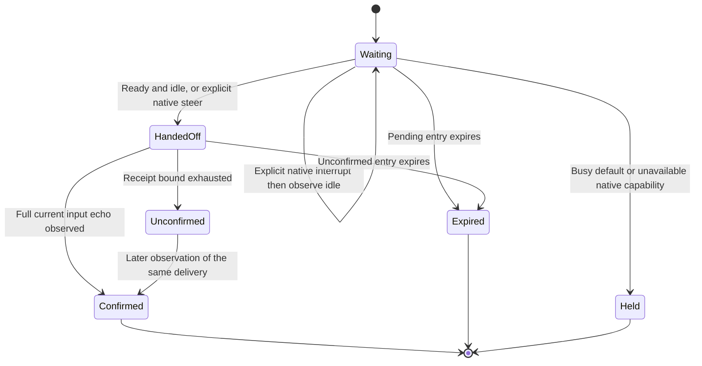

# Fleet input confirmation

## Decision

Use native readiness plus an echoed, delivery-specific input receipt. A transport acknowledgement is not proof that Pi accepted a brief, and an input receipt is not a completed worker report or permission to act.

Options considered:

- **Selected:** observe explicit native readiness, submit once, then poll the existing full echoed handoff proof. Busy default fails loudly; the caller explicitly chooses native steer or native interrupt followed by observed idle.
- Transport acknowledgement alone: rejected by the readiness and receipt negative controls.
- Automatic resend or indefinite pending: rejected by the replay/expiry control. Uncertain handoffs remain observable by delivery ID, not resendable by a drain.
- Raw terminal keypresses: excluded. Native steer uses the existing private same-user worker-control boundary and Pi's `sendUserMessage` API with `deliverAs: 'steer'`.
- Hold: remains available without a handoff. Owner-only effects are outside this delivery mechanism.

The file store serializes read/merge/rename with an exclusive lock and re-reads on every list. The final handoff intent is conditionally claimed under that lock after a fresh prior lookup. Lock contention is bounded to one second and fails closed; a crash-held lock is not automatically removed. Corrupt JSON is not overwritten. This is process concurrency protection, not a power-loss durability guarantee. Busy native steer/interrupt do not require idle TUI readiness before acting; interrupt still requires positive ready/idle settlement before submitting. Known native pre-effect refusals (`stale_turn`, `steer_capability_unavailable`, `steer_prompt_required`) are retryable, unlike uncertain effects.

The native steer endpoint binds repository, session, pane and exact turn, expires after 15 seconds, and claims before calling Pi. One steer can claim each turn. A later prompt needs a fresh observed turn. The fleet store gives pending/unconfirmed entries a two-minute expiry; undated historical entries cannot be drained.

## State view

The view hides read retries and turn replacement; the model includes bounded clock advancement and turn replacement. Neither the diagram nor input confirmation establishes completed model work.

## Model evidence

`FleetDelivery.tla` models default, steer, interrupt, hold and owner paths. The safe configuration checks readiness before handoff, receipt before success, at-most-once/non-expired consumption, exact-turn consumption, and explicit busy handling. Two independent writers begin with the same disk snapshot; exclusive lock acquisition re-reads the current entries before a single-key merge and atomic write. `ConcurrentEntriesRetained` checks that no written entry disappears. The snapshot negative control restores the old stale whole-file write under the same lock and loses an entry.

Observed with installed TLC, one worker:

| Configuration | Checker exit | Observation |
| --- | ---: | --- |
| `FleetDelivery.cfg` | 0 | 2556 distinct states, complete exploration, no errors |
| `FleetDelivery-unsafe-ready.cfg` | 12 | `ReadinessBeforeHandoff` violated |
| `FleetDelivery-unsafe-receipt.cfg` | 12 | `ReceiptBeforeSuccess` violated |
| `FleetDelivery-unsafe-replay.cfg` | 12 | `NeverReplay` violated |
| `FleetDelivery-unsafe-turn.cfg` | 12 | `ExactTurn` violated |
| `FleetDelivery-unsafe-busy.cfg` | 12 | `ExplicitBusyChoice` violated |
| `FleetDelivery-unsafe-snapshot.cfg` | 12 | `ConcurrentEntriesRetained` violated |

All obligations have registered negative controls in `config/model-negative-controls.v1.json`, checked by `tests/test_model_negative_controls.mjs`.

Reproduce by copying this model and configurations into a new repository-local `.scratch` directory. Run installed TLC with `-workers 1 -config <config> -metadir <new-output-directory> <model>`. Use a separate output directory for each configuration and retain the full output. The installed `statechart-pi` adapter can perform the same bounded run without installing anything.

These finite checks assume trustworthy native identity/readiness observations, an atomic private request claim, and serialized Pi lifecycle callbacks. They do not model filesystem replacement attacks, UI rendering, transport crashes, arbitrary session reuse, scheduling fairness or eventual model completion. Sender death does not authorize a resend. An already claimed request may finish only in the same live turn; listener-side identity/expiry checks precede its native effect. Source correspondence is supported by fake-adapter tests, not a formal refinement proof.

## Test-first and delivery history

The first attempt preserved its work locally on `fix/fleet-delivery-confirmation` without pushing. Its incrementally expanded baseline locks could not be refreshed for the final test set. The explicit continuation decision selected a fresh `fix/fleet-delivery-confirmation-v2` branch, preserving the first branch and all evidence.

The complete regression tests, native endpoint fakes and decision model were committed before implementation. One host baseline run observed assertion failures on the unchanged base and froze the complete test set. The implementation was committed afterwards. A subsequent main merge uses `--no-ff`, never a rebase or force-push. Host gate results, any refresh refusal and final verification are reported separately in the draft PR; this document is not a gate-pass claim.

## Runtime limits and rollout

No installed copy, live pane, real pending store or real worker-control endpoint was used during development. The native readiness fields, steer rendering and abort settlement require a real Pi smoke check after an owner-managed install into fresh processes. An old adapter or listener must fail loudly rather than silently fall back to terminal control.

The installed fleet caller already imports tracked `submitGuarded`, so its operator-specific untracked script is not copied into the repository. Deploy the updated fleet module, communication adapter and native listener together; the source change alone does not update installed or running processes.
