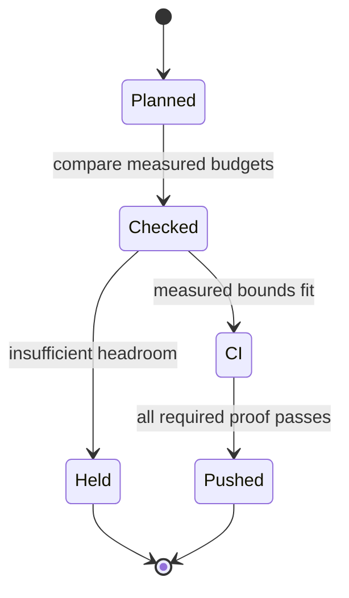

# Audited native-proof budget transition

Decision: the owner-delegated 22:05 budget instruction selects a separate native-proof Buildkite job. Keep the 25% guard and all existing per-command test caps. No runtime history or baseline lock is edited.

## Measurements and arithmetic

The exact-head native proof on `65b5c10` passed in 1586.896s; its supervisor recorded 1586.978s. Against 1800s, remaining headroom is 11.8%. The unchanged guard defines headroom as `(cap - elapsed) / cap`, so the minimum cap is `ceil(1586.978 / 0.75) = 2116s`, not 1984s. At 2400s the measured headroom is **33.9%**, not 51%. Both native admission and its aggregate supervisor now use 2400s; pre-push stays 1800s, shared checks stay 600s, and native per-command caps stay 240s.

Correction to the earlier hold report: the merged #231 pipeline already gives the combined gate job **45 minutes**, not 25. The stale 25-minute claim was corrected by reading the committed pipeline before this transition. Split native proof gets the requested 40-minute job; the original shared job keeps its existing 45-minute outer cap. Every original job remains, and final aggregation depends on the new native job too.

## Model checked before pipeline changes

The installed-only statechart adapter checked a scratch model first. No Java/TLC installation or downloads occurred. A first parser-precedence failure is preserved in scratch; the corrected model produced:

| Configuration | Generated / distinct / queued | Result |
| --- | --- | --- |
| split, 2400s native | 505 / 404 / 0 | NoRedPush, Headroom, SplitCanRun pass |
| single, 2400s | 404 / 303 / 0 | safety holds by refusing admission |
| existing single, 2700s | 505 / 404 / 0 | safety passes within the modeled bounds |
| unchecked single, 2400s | 102 / 102 / 100 | Headroom violated |
| unchecked historical 1500s | 304 / 304 / 100 | NoRedPush violated |
| split reachability witness | 304 / 304 / 100 | NeverPushed violated as intended |

The current split and the existing 45-minute single job both hold safety under these bounds. Split is selected because it gives native proof its own measured budget and failure/artifact boundary, rather than inflating the whole shared job. The model includes rounded native 1587s, shared 163s, 100s setup and 0..100s jitter. At the worst modeled split runtime (1787s), native headroom is 25.5%. Larger unmodeled delays are not proved safe; future measured guard failures still block. The model does not prove OS timeout delivery, host contention bounds or arbitrary future tests.

No modeled transition is hidden in this view; jitter values and predicate details are aggregated. The unsafe controls replay as runtime headroom and pipeline-conformance tests.

## Audited configuration route

A new Treehouse lease (slot 14) was acquired from fetched main `20d13e3`. The reused slot contained an older ignored lease-start record; it was preserved byte-for-byte under `.local/prior-lease-starts/` before the native writer exclusively recorded the new lease start at main. Original slot-6 attempts and all evidence remain untouched.

The pipeline change only separates the existing native command and its prerequisites into a bounded job, retains original jobs/install checks and adds the final dependency. The exact-file allowance changes from `6735353bd5eb8dfc220d95e8ef5ff9b933f3bbb09e616f1505b931df65921c30` to `85eeaacb80ccde5d5bdd7ac2522a55ede57fc7323111b1efc49c02dac329a987`; it is not widened to other paths/content. Two keyed mutation contracts are appended; all inherited keys and `.driver/test-gate.json` caps are retained. The inherited `observability-required-by-aggregate-gate` exact mutation is rebased onto the approved dependency list: both before/after retain `native-proof`, and only the mutant removes `observability`. The first main-4025215 native check blocked after 1619.644s because the historical exact string no longer matched; that attempt and its lock remain unchanged. This contract correction requires another fresh baseline, not additive refresh of the frozen control. Full native baseline/check in the fresh lease is required after adopting this prepared configuration. No old frozen configuration is rewritten through additive refresh.

Conformance tests were authored and observed red before implementation. Final fresh-lease native evidence, full-suite results and Buildkite observations must be recorded separately; the model is not an implementation or CI pass.
