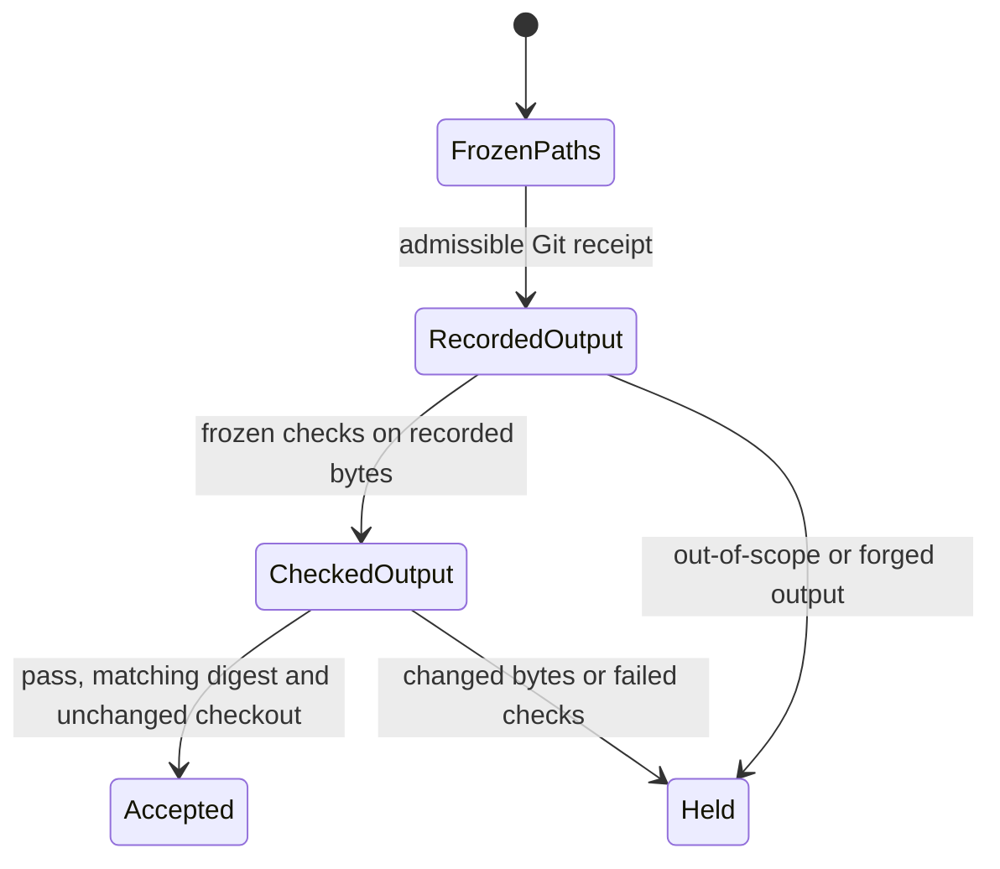

# Worker output contract: choose observed bytes (A)

Flockmate decision, relaying the owner's standing unattended-work instruction,
17 November 2026, 13:45 London. Include this decision in the G8 draft PR body.

## Decision gate

- **A, selected:** freeze output paths before dispatch, record actual Git-blob
  digests, and require the frozen G8 checks on those recorded bytes.
- **B:** retain predeclared output SHA everywhere; repairs require the audited
  redeclaration route. Modeled as a verified external refresh, not implemented
  as a new custom refresh mechanism.
- **Hold:** retain the receipt safeguards without claiming a working repair loop.

Both A and B satisfy the bounded safety model. A also reaches a repaired worker
output without a declaration refresh, so adopt A as directed. Legacy non-worker
steps retain their exact predeclared SHA behavior. There is no path-set expansion:
this version's frozen set is still the single `step.artifact` path.

The view omits terminal self-loops, legacy branches and B's separately audited
refresh. It is not proof.

## Model and exact results

`Gap8OutputContract.tla`, corresponding cfgs and `tlc-gap8-output-*.out`.
TLC2.19, installed OpenJDK27, one worker; complete sanitized output retained.

| Config | Checker exit | Generated / distinct | Result |
|---|---:|---:|---|
| A | 0 | 63 / 31 | all five invariants hold |
| B | 0 | 68 / 33 | all five invariants hold |
| Hold | 0 | 8 / 4 | all five invariants hold |
| unsafe-check | 12 | 36 / 23 | ChecksOnRecordedBytes |
| unsafe-scope | 12 | 4 / 4 | FrozenPathsOnly |
| unsafe-legacy | 12 | 12 / 11 | LegacyUnchanged |
| unsafe-fresh | 12 | 54 / 31 | NoTOCTOU |
| unsafe-digest | 12 | 10 / 10 | RecordedActualBytes |
| reach-repair | 12 | 44 / 27 | expected NeverRepairedWorker witness |

Reproduce with the installed statechart-pi `run-tlc.mjs --spec
.scratch/g8-output-contract/Gap8OutputContract.tla --config
.scratch/g8-output-contract/Gap8OutputContract-A.cfg --out
.scratch/g8-output-contract/NEW-RUN --timeout-seconds 60`, with the approved
existing TLC jar and Java selected. Scratch contains the copied model/configs
and original result.json command records. No checker installation or count tuning.

## Enforcement and conformance

`scripts/workflow_runner_outputs.mjs` reads only regular tracked Git blobs.
`verifyReceipt` retains ancestry, current HEAD, branch, path delta, epoch, writer,
actor and dispatch checks. Changed worker bytes require an explicit `outputs`
record matching the observed blob; a worker's digest assertion alone is never
trusted. The runner persists its own observed output record. Old fixed-byte
worker receipts may still enter with the predeclared bytes, but every newly
persisted worker receipt receives observed outputs and the new check binding.

`exitRequest` binds the output-list digest alongside commit and checks digest.
Checks verify that identity before and after execution. Advance reobserves HEAD,
cleanliness, actual output bytes and the check evidence's output digest. A pass
for another digest, a symlink blob, a changed tree, or an outside-path commit
cannot advance. Non-worker receipts use the unchanged legacy SHA branch.

`tests/test_workflow_runner_exit_receipt_contract.mjs` is self-contained and has
one case per invariant plus the real-Git repair reproduction. Before this
implementation: six tests, five assertion failures and one legacy control pass.
After: six pass; combined frozen exit suites plus these tests:37/37. Local logs:
`.scratch/g8-output-contract/{red-local,green-local}.out`. These are local
behavioral observations, not accepted native fail-first locks. Native acceptance
still awaits the independently reviewed loader-classification repair.

## Bounds and return to G8

The model covers the runner's admitted output protocol, not an OS write jail for
an independently executing worker. Unexpected worker writes are untrusted and
are rejected by the receipt boundary; this is not a claim that arbitrary host
processes cannot touch a checkout. Git objects are immutable, SHA collisions and
malicious same-uid replacement during host checks are excluded. The concrete
before/after and advance observations detect tree drift; they do not establish
an OS-wide absence of transient concurrent writes. The SSH guest-check route
additionally requires read-only checkout media and a protected supervisor in the
pinned image. No weaker monitor is substituted for that prerequisite.

Next: complete real CLI/Pi gap-return lifecycle and production guest wiring,
then audited native baseline, mutations, official gates and draft-only review.
This decision resolves the fixed-output-SHA conflict, not those remaining gates.
