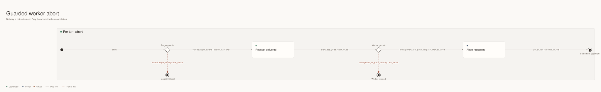

# Guarded worker abort

`agentic_herdr_communication` accepts `abort` for the current turn of a validated non-coordinator Pi role. It writes a request, not a terminal command. The worker calls `ctx.abort()` in-process. In Pi's TUI this is the same handler as Escape.

## Use and receipt

1. Observe `get(role)`. A supported listener exposes `observation.sessionId` and `observation.abortTarget` with a Pi `turnId`, active `toolCallIds` and `running`.
2. Request `abort` with `role`, that `turnId` and/or an active `toolCallId`, and a nonempty `reason` (at most 1,024 UTF-8 bytes). Both supplied identities must match. `allowPiQueueRestore` defaults to false.
3. `ok: true, status: delivered` means a request was atomically published. `abortedAt` is the request time, not cancellation time. Repeated requests for the same session/turn return the original receipt without a second publication. Once the turn is finished, abort is refused rather than replayed.
4. Observe `get` or `read` later for actual cancellation or idle state. A receipt, or even `abort_requested` acknowledgment, does not prove settlement. A refused worker acknowledgment is stored in the channel for diagnosis. `get` does not infer completion from that acknowledgment.

The adapter reuses `requireRole`, `observeRole`, `publicAgentObservation` and the canonical repository/lease resolver. Unknown roles, non-Pi agents, untrusted repositories and coordinator targets are refused. Missing turn identity, stale identity, idle/done targets and missing/stale listener capability are also refused. The capability pane must exactly match Herdr's observed `pane_id`, exposed as `observation.paneId`. Missing or mismatched observed panes refuse with `abort_capability_unavailable`; the audit outcome retains that code and the observed pane (or null). A missing session identity cannot fall back to a pane label.

Herdr's status sequence is exposed as an observation only. The listener cannot safely translate a status change into a Pi lifecycle boundary, so this implementation uses the allowed **Pi turn identity** alternative, not `state_change_seq` as an abort token. A unique token is generated on every `turn_start`, including after a reload or repeated turn index. Tool identity is tracked through execution start/end. Turn end and agent end invalidate the running state.

## File channel and containment

The existing `extensions/herdr-communication.ts` loads the worker listener on startup. It detects Herdr through the existing workspace/tab/pane environment convention. Herdr does not set a role environment variable: the adapter validates the role against its observation, and the listener binds the real session and pane instead of trusting a name.

Storage lives under `$PI_CODING_AGENT_DIR/agentic/worker-control/` (default profile: `$PI_HOME/agent`). Each session uses a SHA-256 directory name, so arbitrary session identifiers cannot become path segments. This location is PAD-owned runtime data shared by same-user Pi processes. It does not touch repository content, the Treehouse lease, settings, model profiles, registration or approval records. It is not a boundary against hostile code already running as the same OS user.

- `capability.json`: versioned session/pane/repository, running turn, active tools, heartbeat. Fresh for 15 seconds, refreshed every second and at lifecycle events. Missing or unsupported capabilities fail closed with `abort_capability_unavailable`.
- `request-<turn hash>.json`: exclusive atomic publication of one immutable request and original receipt per turn. The 15-second request lifetime prevents a delayed request from gaining effect later. One clock read supplies `createdAt`, `expiresAt` and receipt `abortedAt`; the listener requires an exact 15-second window.
- `ack-<turn hash>.json`: exclusive claim before `ctx.abort()`. Duplicate watch/poll events and reloads cannot replay an already claimed request. An interrupted process between claim and invocation can therefore lose an abort, never repeat it. Settlement remains unknown until observed.
- `audit.jsonl`: append-only attempt and outcome records, with target role, observed repository/session when available, requested turn/tool, reason, requesting session, timestamp and outcome. Refusals before observation have null observed identities, not invented identities. An unwritable attempt audit refuses before publication. If only the outcome append fails after publication, the receipt stays delivered with `auditWarning`, avoiding a false report that nothing was delivered.

Directories and files are same-user owned, with private control/session directories. Symlinked endpoints, writable-by-others records, nonregular files and oversized JSON are refused. JSON replacement uses same-directory rename. Immutable requests and acknowledgments use an exclusive hard-link publication to avoid cross-process duplicates. Watch notifications are only hints; a one-second unreferenced poll reads at most the current turn's request. It never scans old sessions or turns. Shutdown closes the watcher/timer and invalidates capability. Historical request and audit records are retained; automatic retention cleanup is deliberately not introduced here.

Existing communication handles target and repository validation, but has no in-process worker endpoint. Approval and recovery ledgers carry unrelated authority semantics. This adds one focused shared module for the listener/channel and uses their append-only JSONL convention without mixing cancellation observations into approvals.

## Limits and rollout

- **Pi queue caveat:** TUI `ctx.abort()` restores Pi-internal steering/follow-up messages into the editor, unsent. The worker refuses `pi_queue_pending` unless `allowPiQueueRestore: true` explicitly permits that behavior. This is not queue preservation. PAD's own delivery records (`promptSent: false`) are untouched and become deliverable when the worker is later observed idle. Delivery observations expose `promptSent` at the confirmed queued/delivered boundary.
- **Native-work caveat:** synchronous native code blocks Node's event loop. Neither Escape, `ctx.abort()` nor this listener can preempt it before it yields. This action supports awaiting asynchronous tools, not uninterruptible native calls. The asgrep backend workaround is a separate change.
- No kill, signal, restart, shutdown request, pane input, generic Herdr management command, queue clearing or lease mutation is added. Abort does not create authority or complete a task.
- Installed workers without this listener must return `abort_capability_unavailable`. The feature needs a later owner-published package and fresh worker process. This change does not install or publish anything, and no live abort was performed.

## Verification and model

`tests/test_worker_abort.mjs` uses fake Herdr observations, an AbortSignal-backed blocking tool and fake Pi lifecycle events. It covers cancellation, idle observation, session/lease identity, queued follow-up delivery, unrelated endpoint isolation, target/capability/turn refusals, idempotence, queue opt-in, receipt honesty and instrumented containment. It uses no live Herdr. The host baseline observed seven assertion failures against `origin/main` before implementation, including refusal, receipt and containment assertions; the check phase passes and catches the disabled-abort-route mutation. No test-gate policy was changed. Review regressions additionally prove mismatched or missing observed panes refuse without publication and a ticking clock preserves the exact window and gets `abort_requested`. Against `b31556d`, those tests fail by assertion (`undefined` versus `abort_capability_unavailable`, and `15001 !== 15000`); the other seven tests pass. The prior seven-test lock was preserved separately before obtaining fresh host baselines for the expanded suite; tests stayed locked during implementation.

The Bowerbird source is `worker-abort.bower.json`. `check` reports all states reachable, all states able to finish and no ambiguous events. `journeys` has three paths: observed settlement, worker refusal, coordinator refusal. `WorkerAbort.tla` and its configuration are generated abstractions with free boolean guards, not proofs of filesystem safety, host authorization, queue preservation or event-loop preemption. TLC has not been run. The existing nudge-ledger convention is retained: the model lives beside its scope explanation, and runtime claims come from tests rather than generated diagrams.
